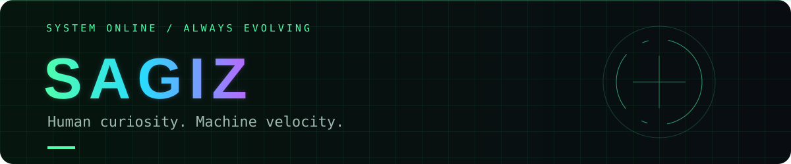

<h2 align="center">Full-Stack Engineer · Systems Architect · Cloud & Edge AI</h2>

<strong>From interface to infrastructure. From bottleneck to breakthrough.</strong>

### ⚡ About Me

I'm **SAGIZ**. I design and deploy end-to-end software solutions, connecting product experience with the architecture that makes it scale. My focus is clean, resilient code, efficient cloud infrastructure, and lightweight AI capabilities that solve practical problems.

I bring a broad technical perspective and a hands-on engineering mindset: trace the bottleneck, understand the tradeoffs, and build a solution that holds up beyond the demo. From frontend interactions to concurrent backend services, I care about how the whole system behaves.

- **Core focus:** Cloud-native architecture, serverless and edge AI, high-concurrency services, and pragmatic system design.
- **Engineering priorities:** Maintainability, performance, reliability, and cloud cost optimization.
- **AI approach:** Choose capabilities that fit the runtime, latency budget, and product need.
- **Availability:** Open for architectural consulting, system audits, and high-impact engineering projects.

### 🧠 How I Work

| Perspective | Engineering approach |
| :--- | :--- |
| **Architecture** | Make boundaries clear, dependencies deliberate, and tradeoffs explicit. |
| **Performance** | Measure first. Find the constraint. Improve what matters. |
| **Cloud & edge** | Put work where it makes sense for latency, scale, and cost. |
| **AI integration** | Connect useful intelligence to real workflows, with checks around its output. |
| **Delivery** | Build end to end, validate behavior, and leave the system easier to evolve. |

### 💻 Tech Stack & Expertise

**Languages**

**Cloud & Infrastructure**

**Frameworks & Runtimes**

**AI & Machine Learning**

### 🤝 Let's Build

Have an architectural bottleneck, an infrastructure challenge, or an AI idea that needs a practical implementation? Let's map the constraints and build a clear path forward.

[**Start a technical conversation →**](https://github.com/sagko/sagko/issues/new) · [**Explore my repositories →**](https://github.com/sagko?tab=repositories) · [**Experiment playbook →**](EXPERIMENTS.md)

> Understand the system. Challenge the limits. Build what comes next.

---

SAGIZ · HUMAN CURIOSITY · MACHINE VELOCITY · CONTINUOUS EVOLUTION

